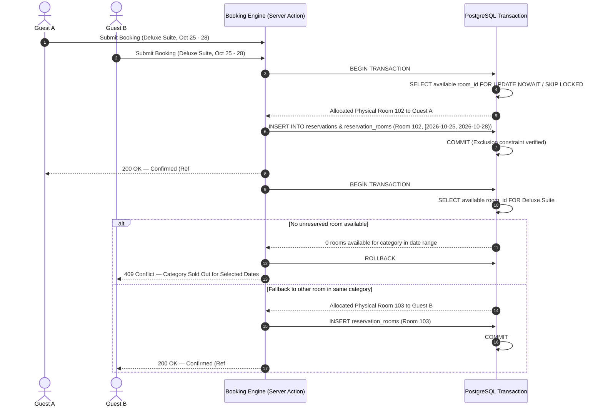

# Medaresha — Application Architecture

## 1. System Overview

Medaresha is structured as a unified, full-stack Next.js 15+ App Router application with a PostgreSQL database backed by Supabase.

```
                              ┌────────────────────────────────────────┐
                              │           Client Web Browsers          │
                              │  (Guests, Front Desk, Housekeeping)    │
                              └───────────────────┬────────────────────┘
                                                  │ HTTPS / WSS
                                                  ▼
┌──────────────────────────────────────────────────────────────────────────────────────────────────────┐
│ Next.js App Router Application (Hosted on Vercel or Node.js Container)                               │
│                                                                                                      │
│  ┌──────────────────────────────┐  ┌──────────────────────────────┐  ┌────────────────────────────┐  │
│  │   Public Marketing & Booking │  │     Staff Authentication     │  │       Admin / PMS Hub      │  │
│  │  - /rooms, /availability     │  │  - /login, /reset-password   │  │  - /admin/reservations     │  │
│  │  - /booking (Guest Form,     │  │  - Session & Role Guards     │  │  - /admin/calendar         │  │
│  │    Confirmation & Lookup)    │  │  - Cookie-based SSR Auth     │  │  - /admin/check-in-out     │  │
│  │  - /facilities, /policies    │  │                              │  │  - /admin/housekeeping     │  │
│  └──────────────┬───────────────┘  └──────────────┬───────────────┘  └─────────────┬──────────────┘  │
│                 │                                 │                                │                 │
│  ┌──────────────┴─────────────────────────────────┴────────────────────────────────┴──────────────┐  │
│  │ Server Actions & Route Handlers (Atomic Booking, Pricing Engine, Payment Webhook, Inventory)   │  │
│  │  - Validation via Zod Schemas                                                                  │  │
│  │  - Idempotency Keys on Booking Creation                                                        │  │
│  │  - Strict Date Arithmetic in UTC + Hotel Timezone Handling                                     │  │
│  └──────────────────────────────────────────────┬─────────────────────────────────────────────────┘  │
└─────────────────────────────────────────────────┼────────────────────────────────────────────────────┘
                                                  │
                                                  ▼
┌──────────────────────────────────────────────────────────────────────────────────────────────────────┐
│ Supabase Managed PostgreSQL Engine                                                                   │
│                                                                                                      │
│  ┌──────────────────────────────┐  ┌──────────────────────────────┐  ┌────────────────────────────┐  │
│  │    PostgreSQL Extensions     │  │     Row Level Security       │  │    Concurrency & Locking   │  │
│  │  - btree_gist (Exclusion)    │  │  - Public: read rooms/rates  │  │  - FOR UPDATE Row Locking  │  │
│  │  - uuid-ossp / pgcrypto      │  │  - Staff: role-scoped access │  │  - daterange EXCLUDE       │  │
│  │                              │  │  - Guests: ref+email lookup  │  │    overlapping constraints │  │
│  └──────────────────────────────┘  └──────────────────────────────┘  └────────────────────────────┘  │
│  ┌──────────────────────────────┐  ┌──────────────────────────────┐  ┌────────────────────────────┐  │
│  │       Supabase Auth          │  │       Supabase Storage       │  │    Realtime Subscriptions  │  │
│  │  - JWT & Refresh Tokens      │  │  - Room & Property Photos    │  │  - New booking alerts      │  │
│  │  - Staff profile sync        │  │  - Public CDN delivery       │  │  - Housekeeping status     │  │
│  └──────────────────────────────┘  └──────────────────────────────┘  └────────────────────────────┘  │
└──────────────────────────────────────────────────────────────────────────────────────────────────────┘
```

---

## 2. Layered Architecture Principles

### 2.1 Presentation Layer (Client & Server Components)
- **Server Components by Default**: Used for data fetching (room listings, policy pages, admin dashboard metric rendering) to minimize client bundle size and provide instant SSR.
- **Client Components for Interactivity**: Booking step forms, interactive calendars, photo lightbox galleries, dynamic filtering, and modals.
- **Design Token Discipline**: All UI elements derive from Tailwind config tokens reflecting the visual aesthetic (`primary-olive: #343B2A`, `primary-ivory: #F5F0E6`, etc.).

### 2.2 Domain & Business Logic Layer
- **No Client-Side Financial Trust**: Prices, taxes, discounts, and room allocations are computed exclusively on the server using authoritative database records.
- **State Machine Isolation**: Reservations follow a strict lifecycle state machine with validation of transitions (e.g., `pending` -> `confirmed` -> `checked_in` -> `checked_out`). Invalid transitions trigger server rejections.

### 2.3 Data Access & Persistence Layer
- **PostgreSQL Database**: Authoritative source of all hotel configuration, rooms, bookings, folios, and stock items.
- **Supabase JavaScript/TypeScript SDK**: Typed database interactions with Supabase client (`@supabase/supabase-js`, `@supabase/ssr`).
- **Database Functions & Triggers**:
  - Double booking exclusion constraints (`EXCLUDE USING gist (room_id WITH =, stay_range WITH &&)`).
  - Stock movement transaction triggers to ensure item quantity balances can never drift from movement records.

---

## 3. Concurrency & High-Integrity Booking Engine

A critical requirement of Medaresha is the prevention of double bookings even during flash sales or simultaneous concurrent requests.



---

## 4. Multi-Tenant Preparedness

Every tenant record includes `property_id UUID REFERENCES properties(id) ON DELETE CASCADE`.
- The initial deployment defaults all queries and operations to the primary seeded boutique hotel property.
- The schema and RLS policies use `property_memberships` linking users to properties with defined roles. Adding a second property in the future simply requires inserting a new property record and assigning authorized staff.
