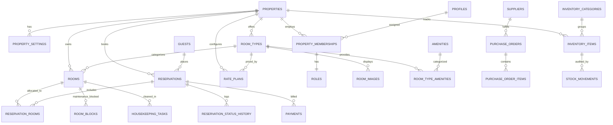

# Medaresha — Database Schema & Relational Architecture

## 1. Relational Entity Overview

The schema is built on Supabase PostgreSQL with extensions:
- `uuid-ossp` or `pgcrypto` for UUID v4 generation.
- `btree_gist` for GiST exclusion constraints (`tstzrange` / `daterange` overlapping checks).

---

## 2. Table Definitions & Key Constraints

### 2.1 Properties & Tenancy
- **`properties`**
  - `id UUID PRIMARY KEY DEFAULT gen_random_uuid()`
  - `name TEXT NOT NULL`
  - `slug TEXT UNIQUE NOT NULL`
  - `description TEXT`
  - `star_rating NUMERIC(2,1)`
  - `address_line1 TEXT NOT NULL`
  - `city TEXT NOT NULL DEFAULT 'Addis Ababa'`
  - `country TEXT NOT NULL DEFAULT 'Ethiopia'`
  - `timezone TEXT NOT NULL DEFAULT 'Africa/Addis_Ababa'`
  - `currency TEXT NOT NULL DEFAULT 'ETB'`
  - `phone TEXT NOT NULL`
  - `email TEXT NOT NULL`
  - `website_url TEXT`
  - `hero_image_url TEXT`
  - `logo_url TEXT`
  - `check_in_time TIME NOT NULL DEFAULT '14:00'`
  - `check_out_time TIME NOT NULL DEFAULT '11:00'`
  - `is_active BOOLEAN NOT NULL DEFAULT true`
  - `created_at TIMESTAMPTZ NOT NULL DEFAULT now()`

- **`property_settings`**
  - `id UUID PRIMARY KEY DEFAULT gen_random_uuid()`
  - `property_id UUID NOT NULL REFERENCES properties(id) ON DELETE CASCADE`
  - `vat_percentage NUMERIC(5,2) NOT NULL DEFAULT 15.00`
  - `service_charge_percentage NUMERIC(5,2) NOT NULL DEFAULT 10.00`
  - `cancellation_grace_hours INT NOT NULL DEFAULT 48`
  - `auto_release_pending_minutes INT NOT NULL DEFAULT 30`
  - `telebirr_merchant_id TEXT`
  - `cbe_account_number TEXT`
  - `bank_transfer_instructions TEXT`

### 2.2 Roles, Profiles & Staff
- **`profiles`**
  - `id UUID PRIMARY KEY REFERENCES auth.users(id) ON DELETE CASCADE`
  - `full_name TEXT NOT NULL`
  - `phone TEXT`
  - `avatar_url TEXT`
  - `created_at TIMESTAMPTZ NOT NULL DEFAULT now()`

- **`property_memberships`**
  - `id UUID PRIMARY KEY DEFAULT gen_random_uuid()`
  - `property_id UUID NOT NULL REFERENCES properties(id) ON DELETE CASCADE`
  - `user_id UUID NOT NULL REFERENCES profiles(id) ON DELETE CASCADE`
  - `role TEXT NOT NULL CHECK (role IN ('owner', 'manager', 'receptionist', 'housekeeping', 'accountant', 'inventory_officer'))`
  - `is_active BOOLEAN NOT NULL DEFAULT true`
  - `created_at TIMESTAMPTZ NOT NULL DEFAULT now()`
  - `UNIQUE(property_id, user_id)`

### 2.3 Room Catalog & Physical Inventory
- **`room_types`**
  - `id UUID PRIMARY KEY DEFAULT gen_random_uuid()`
  - `property_id UUID NOT NULL REFERENCES properties(id) ON DELETE CASCADE`
  - `name TEXT NOT NULL`
  - `slug TEXT NOT NULL`
  - `short_description TEXT NOT NULL`
  - `full_description TEXT NOT NULL`
  - `max_adults INT NOT NULL DEFAULT 2`
  - `max_children INT NOT NULL DEFAULT 1`
  - `max_occupancy INT NOT NULL DEFAULT 2`
  - `base_price_per_night NUMERIC(12,2) NOT NULL`
  - `extra_person_fee NUMERIC(12,2) NOT NULL DEFAULT 0.00`
  - `size_sqm NUMERIC(6,2)`
  - `bed_configuration TEXT NOT NULL`
  - `is_active BOOLEAN NOT NULL DEFAULT true`
  - `sort_order INT NOT NULL DEFAULT 0`
  - `created_at TIMESTAMPTZ NOT NULL DEFAULT now()`
  - `UNIQUE(property_id, slug)`

- **`rooms`**
  - `id UUID PRIMARY KEY DEFAULT gen_random_uuid()`
  - `property_id UUID NOT NULL REFERENCES properties(id) ON DELETE CASCADE`
  - `room_type_id UUID NOT NULL REFERENCES room_types(id) ON DELETE RESTRICT`
  - `room_number TEXT NOT NULL`
  - `floor INT NOT NULL DEFAULT 1`
  - `housekeeping_status TEXT NOT NULL DEFAULT 'clean' CHECK (housekeeping_status IN ('clean', 'dirty', 'in_progress', 'inspected', 'out_of_service'))`
  - `is_active BOOLEAN NOT NULL DEFAULT true`
  - `notes TEXT`
  - `created_at TIMESTAMPTZ NOT NULL DEFAULT now()`
  - `UNIQUE(property_id, room_number)`

- **`room_blocks` (Maintenance / Offline Holds)**
  - `id UUID PRIMARY KEY DEFAULT gen_random_uuid()`
  - `property_id UUID NOT NULL REFERENCES properties(id) ON DELETE CASCADE`
  - `room_id UUID NOT NULL REFERENCES rooms(id) ON DELETE CASCADE`
  - `start_date DATE NOT NULL`
  - `end_date DATE NOT NULL`
  - `reason TEXT NOT NULL`
  - `block_type TEXT NOT NULL CHECK (block_type IN ('maintenance', 'renovation', 'management_hold'))`
  - `created_by UUID REFERENCES profiles(id)`
  - `created_at TIMESTAMPTZ NOT NULL DEFAULT now()`
  - `CONSTRAINT valid_block_range CHECK (end_date > start_date)`

### 2.4 Reservations & Guests
- **`guests`**
  - `id UUID PRIMARY KEY DEFAULT gen_random_uuid()`
  - `property_id UUID NOT NULL REFERENCES properties(id) ON DELETE CASCADE`
  - `first_name TEXT NOT NULL`
  - `last_name TEXT NOT NULL`
  - `email TEXT NOT NULL`
  - `phone TEXT NOT NULL`
  - `identification_type TEXT CHECK (identification_type IN ('passport', 'national_id', 'driving_license'))`
  - `identification_number TEXT`
  - `country TEXT NOT NULL DEFAULT 'Ethiopia'`
  - `preferences TEXT`
  - `internal_notes TEXT`
  - `created_at TIMESTAMPTZ NOT NULL DEFAULT now()`

- **`reservations`**
  - `id UUID PRIMARY KEY DEFAULT gen_random_uuid()`
  - `property_id UUID NOT NULL REFERENCES properties(id) ON DELETE CASCADE`
  - `reservation_number TEXT NOT NULL UNIQUE` (e.g. `MED-2026-XXXX`)
  - `guest_id UUID NOT NULL REFERENCES guests(id) ON DELETE RESTRICT`
  - `check_in_date DATE NOT NULL`
  - `check_out_date DATE NOT NULL`
  - `num_adults INT NOT NULL DEFAULT 1`
  - `num_children INT NOT NULL DEFAULT 0`
  - `status TEXT NOT NULL DEFAULT 'pending' CHECK (status IN ('pending', 'awaiting_payment', 'confirmed', 'checked_in', 'checked_out', 'cancelled', 'no_show'))`
  - `payment_status TEXT NOT NULL DEFAULT 'unpaid' CHECK (payment_status IN ('unpaid', 'partially_paid', 'paid', 'refunded'))`
  - `subtotal_amount NUMERIC(12,2) NOT NULL`
  - `service_charge_amount NUMERIC(12,2) NOT NULL`
  - `vat_amount NUMERIC(12,2) NOT NULL`
  - `total_amount NUMERIC(12,2) NOT NULL`
  - `currency TEXT NOT NULL DEFAULT 'ETB'`
  - `special_requests TEXT`
  - `estimated_arrival_time TIME`
  - `cancellation_reason TEXT`
  - `cancelled_at TIMESTAMPTZ`
  - `idempotency_key TEXT UNIQUE`
  - `created_at TIMESTAMPTZ NOT NULL DEFAULT now()`
  - `updated_at TIMESTAMPTZ NOT NULL DEFAULT now()`
  - `CONSTRAINT check_reservation_dates CHECK (check_out_date > check_in_date)`

- **`reservation_rooms` (Physical Room Allocation & Double-Booking Guard)**
  - `id UUID PRIMARY KEY DEFAULT gen_random_uuid()`
  - `reservation_id UUID NOT NULL REFERENCES reservations(id) ON DELETE CASCADE`
  - `room_type_id UUID NOT NULL REFERENCES room_types(id) ON DELETE RESTRICT`
  - `room_id UUID REFERENCES rooms(id) ON DELETE RESTRICT`
  - `stay_range DATERANGE NOT NULL`
  - `nightly_rate NUMERIC(12,2) NOT NULL`
  - `created_at TIMESTAMPTZ NOT NULL DEFAULT now()`
  - `EXCLUDE USING gist (room_id WITH =, stay_range WITH &&) WHERE (room_id IS NOT NULL)`

### 2.5 Payments & Financial Ledger
- **`payments`**
  - `id UUID PRIMARY KEY DEFAULT gen_random_uuid()`
  - `property_id UUID NOT NULL REFERENCES properties(id) ON DELETE CASCADE`
  - `reservation_id UUID NOT NULL REFERENCES reservations(id) ON DELETE CASCADE`
  - `transaction_reference TEXT UNIQUE NOT NULL`
  - `amount NUMERIC(12,2) NOT NULL`
  - `currency TEXT NOT NULL DEFAULT 'ETB'`
  - `payment_method TEXT NOT NULL CHECK (payment_method IN ('cash', 'credit_card', 'telebirr', 'cbe_birr', 'bank_transfer', 'online_gateway'))`
  - `payment_status TEXT NOT NULL DEFAULT 'completed' CHECK (payment_status IN ('pending', 'completed', 'failed', 'refunded'))`
  - `recorded_by UUID REFERENCES profiles(id)`
  - `notes TEXT`
  - `created_at TIMESTAMPTZ NOT NULL DEFAULT now()`

### 2.6 Consumable Stock & Purchasing
- **`inventory_items`**
  - `id UUID PRIMARY KEY DEFAULT gen_random_uuid()`
  - `property_id UUID NOT NULL REFERENCES properties(id) ON DELETE CASCADE`
  - `sku TEXT NOT NULL`
  - `name TEXT NOT NULL`
  - `category TEXT NOT NULL`
  - `unit_of_measure TEXT NOT NULL` (e.g. `kg`, `bottle`, `pack`, `piece`)
  - `current_stock NUMERIC(10,2) NOT NULL DEFAULT 0.00`
  - `reorder_threshold NUMERIC(10,2) NOT NULL DEFAULT 10.00`
  - `unit_cost NUMERIC(12,2) NOT NULL DEFAULT 0.00`
  - `created_at TIMESTAMPTZ NOT NULL DEFAULT now()`
  - `UNIQUE(property_id, sku)`

- **`stock_movements`**
  - `id UUID PRIMARY KEY DEFAULT gen_random_uuid()`
  - `item_id UUID NOT NULL REFERENCES inventory_items(id) ON DELETE CASCADE`
  - `movement_type TEXT NOT NULL CHECK (movement_type IN ('receipt', 'issue', 'waste', 'return', 'adjustment'))`
  - `quantity NUMERIC(10,2) NOT NULL`
  - `balance_after NUMERIC(10,2) NOT NULL`
  - `unit_cost NUMERIC(12,2) NOT NULL`
  - `reason TEXT NOT NULL`
  - `recorded_by UUID REFERENCES profiles(id)`
  - `created_at TIMESTAMPTZ NOT NULL DEFAULT now()`
